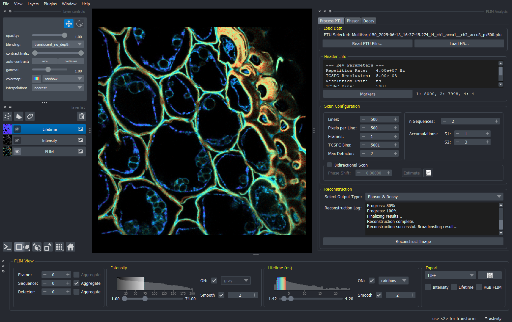
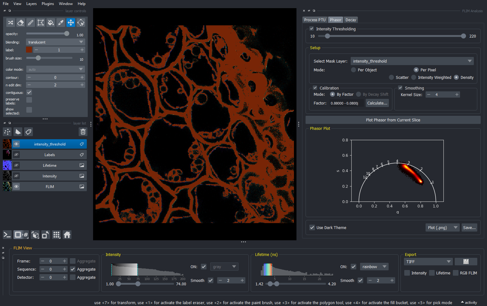
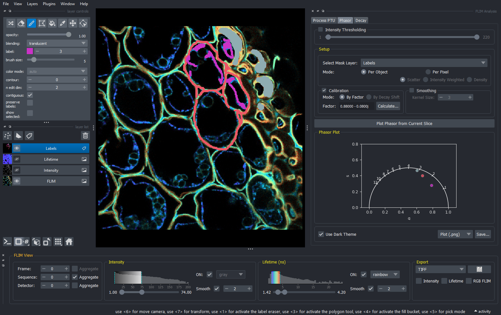
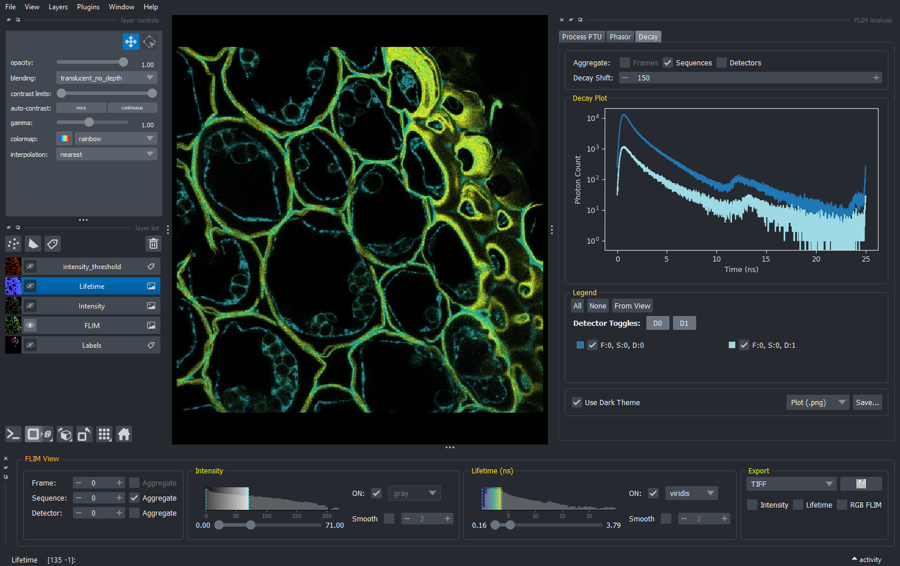

# FLOPA

## Deprecated repository

**This repository is no longer maintained.**

FLOPA has moved to a dedicated **napari plugin** repository:

**https://github.com/cockovaz/napari-flopa**

Please use the new repository for the current implementation, installation instructions, documentation, bug reports, and further development.

---

## About FLOPA

**FLOPA — FLIM Open, Process, and Analyze** — is a Python-based tool for opening, processing, and analysing **Fluorescence Lifetime Imaging Microscopy (FLIM)** data.

The original project was developed as a Python package and napari-based widget for working with time-tagged time-resolved (TTTR) FLIM data, in particular `.ptu` files. It provided functionality for reconstructing FLIM data and generating intensity images, lifetime-related measurements, TCSPC decay histograms, and phasor representations.

This repository contains the **original/deprecated implementation** of FLOPA and is retained primarily for historical reference.

The deprecated implementation included functionality for:

| 1. PTU Reconstruction & Configuration | 2. Pixel-based Phasor |
| :---: | :---: |
|  |  |
| **3. Object-based Phasor** | **4. Decay Curve** |
|  |  |


Some of these capabilities have since been reorganized and extended in the maintained napari plugin.

---

---

## Migration to the napari plugin

Development has moved from this repository to:

**[napari-flopa](https://github.com/cockovaz/napari-flopa)**

See the **[napari-flopa repository](https://github.com/cockovaz/napari-flopa)** for the current feature set and documentation.

---

## Do not use this repository for new installations

The installation instructions previously provided here referred to the development version of FLOPA and are no longer the recommended way to install or use the software.

For a current installation, use the maintained package instead:

```bash
pip install "napari-flopa[all]"
```

Or, if napari is already installed in the target environment:

```bash
pip install napari-flopa
```

The current plugin requires **Python ≥ 3.11**. See the maintained repository for the complete installation and usage instructions.

---


## Source code history

This repository represents an earlier stage of the FLOPA project. It is preserved so that previous code, notebooks, documentation, and development history remain accessible.

The original repository contained the core Python code together with example notebooks and tests.

For active development, please use:

**https://github.com/cockovaz/napari-flopa**

---

## License

This original repository was distributed under the **GPL-3.0** license.

Note that the maintained `napari-flopa` project is distributed under the **MIT license**. Refer to the license in that repository for the terms applicable to the current implementation.

---

## Status

**Deprecated / archived for historical reference.**

No new features or bug fixes are planned for this repository.

**Current project:** [napari-flopa](https://github.com/cockovaz/napari-flopa)


1.  Make sure your virtual environment is activated.
2.  Start a Python interpreter, an IPython session, or a Jupyter Notebook.
3.  Import and use the functions directly.
* Navigate to the /notebooks directory to explore the example notebooks.
